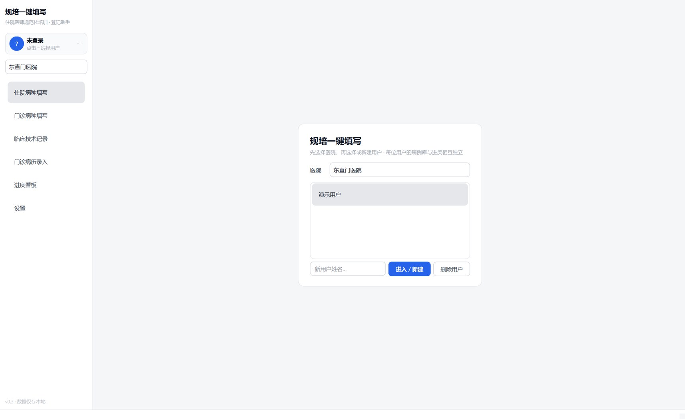
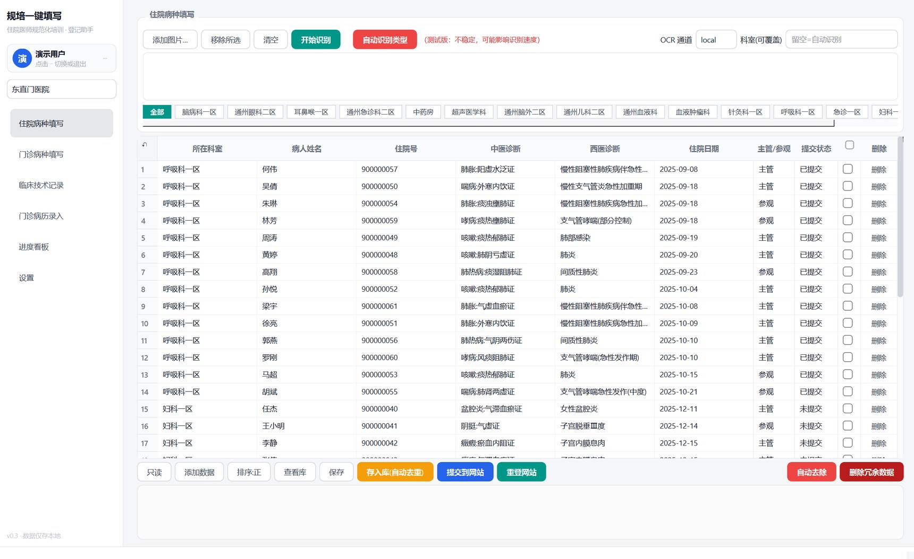
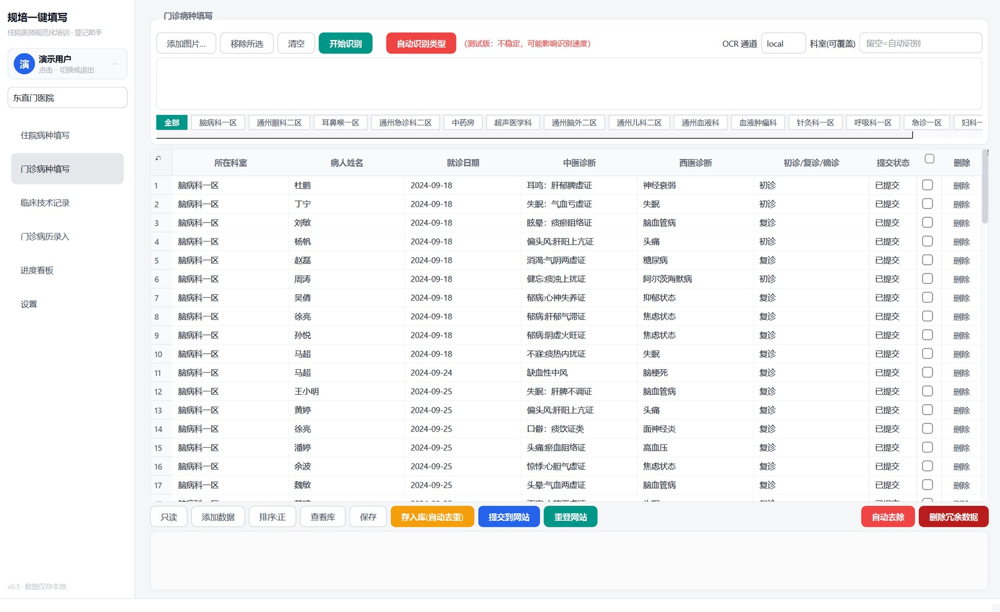
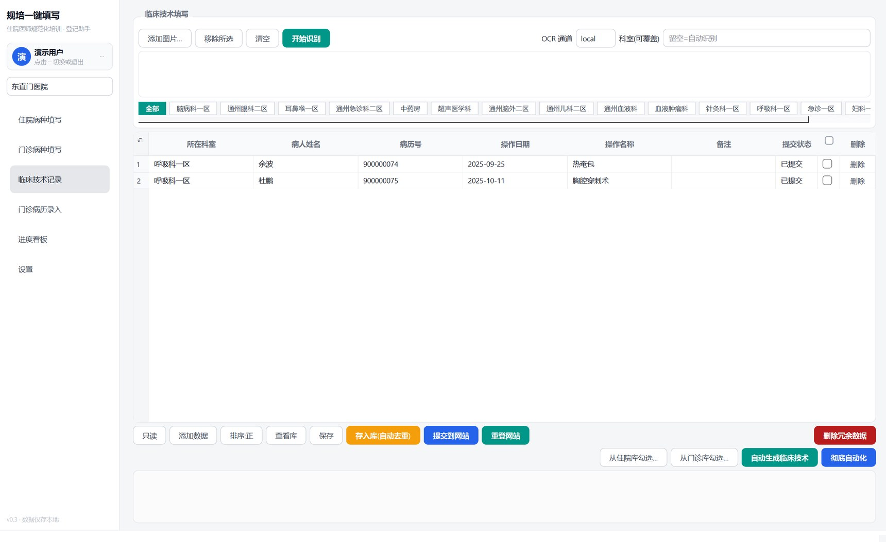
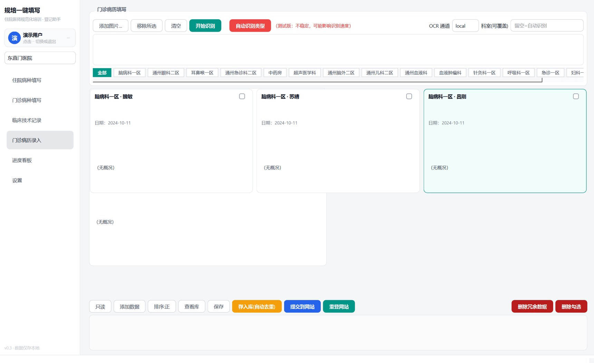
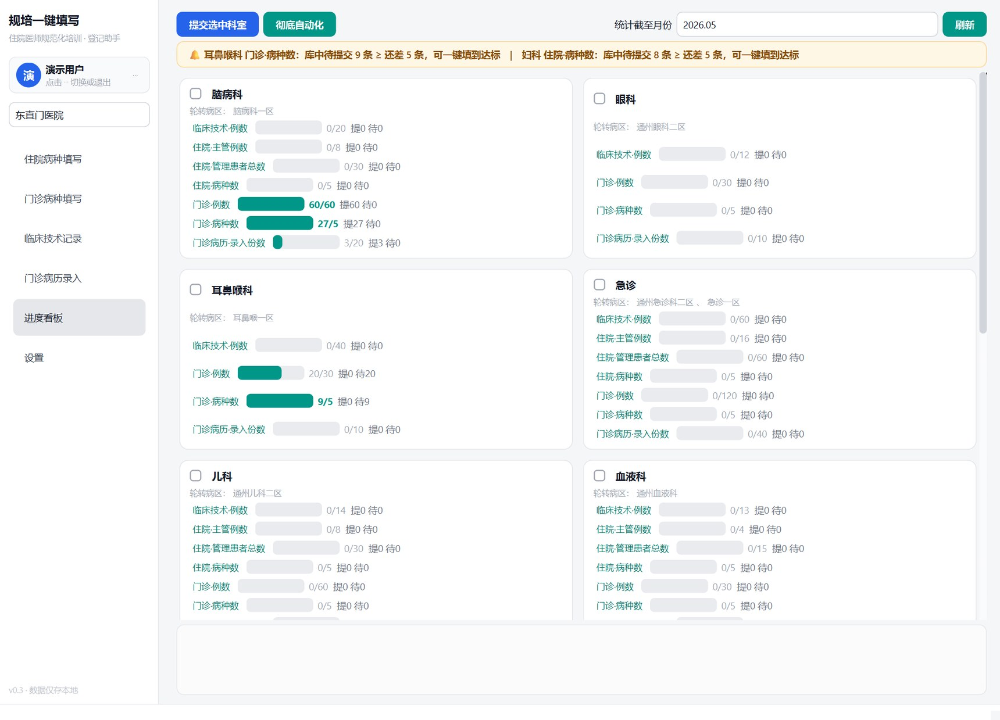
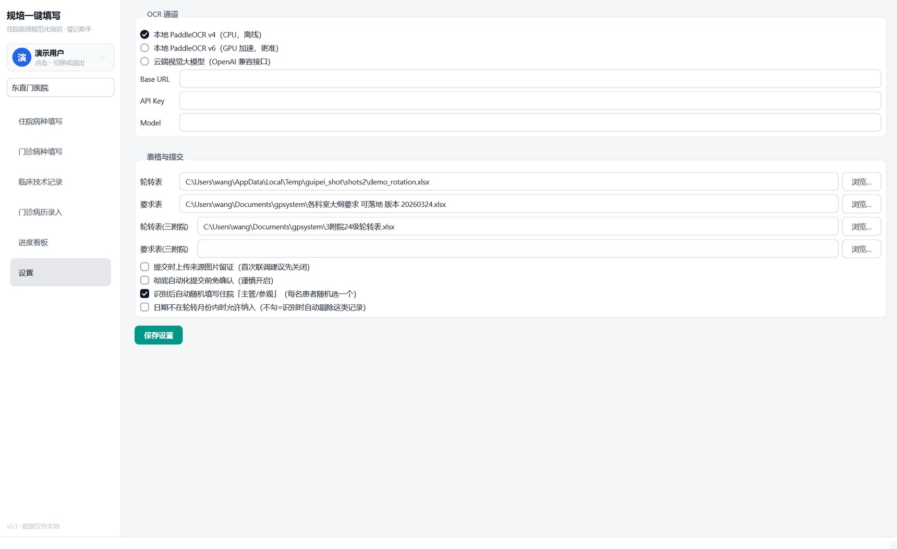

# 规培助手 V1.2.0

> **V1.2.2 已发布** —— 同为**功能补丁**（2.5 MB）。V1.2.0 / V1.2.1 用户都直接装这个即可，
> 不用先装 V1.2.1，重复安装也不会冲突。详见下方 [V1.2.2 更新内容](#v122-更新内容)。
>
> **V1.2.1 已发布** —— 本次为**功能补丁**（2.5 MB），已装 V1.2.0 的同学直接装补丁即可，
> 不用重新下载 330 MB / 1.9 GB 的完整安装包。详见下方 [V1.2.1 更新内容](#v121-更新内容)。

**明显简化了整体流程，基本实现一键化并提高可视化程度**（本程序为测试版程序，如有 bug 反馈可按下方联系方式提交）。

支持北京中医药大学**东直门医院**与**第三附属医院**两套 HIS 版式。

[**⬇️ 下载安装包**](https://github.com/daveandm/beijingtcmguipeiionestep/releases/latest) ·
[安装说明](https://github.com/daveandm/beijingtcmguipeiionestep/releases/download/v1.2.0/Install-Guide.txt) ·
[使用说明](https://github.com/daveandm/beijingtcmguipeiionestep/releases/download/v1.2.0/User-Manual.txt) ·
[图文教程](https://github.com/daveandm/beijingtcmguipeiionestep/releases/download/v1.2.0/Quick-Start-Tutorial.docx)

> **建议使用前务必提前阅读图文教程。** 为保护患者隐私，具体住院病种及门诊病种等拍摄要求示例图未收录，
> 下方界面图中的患者姓名与住院号也已替换为示例数据。
> 需要示例图、更详细的操作示意，或想看具体视频使用教程，可**微信联系 dave**，或在**提瓦特找 109858638**。



**进入程序先选用户与医院**：输入姓名、选好医院即可开始。
**24 级规培轮转科室已自动依照官方 Excel 收录**，输入姓名 + 医院即可自动匹配你的轮转科室；
其他同学如有需要，可在**设置界面**修改对应的 Excel，或把表格提交过来收录。

---

## 界面一览

左侧六个页面就是完整的工作流：**三个录入页 → 一个病历页 → 看板 → 设置**。

### 住院病种填写

住院病人列表的照片丢进去，自动拆成「姓名 / 住院号 / 中医诊断 / 西医诊断 / 住院日期」。
顶部科室 chips 一点即筛选；底部按钮对应「存入库 → 提交到网站」。



### 门诊病种填写

门诊列表版式不同（多一列「初诊/复诊/确诊」、日期取就诊时间），单独一套识别规则。



### 临床技术记录

可以「从住院库勾选」「从门诊库勾选」复用已有病例，也可以按轮转表算出的**缺口自动补足**，
再一键走完「生成 → 入库 → 提交」。



### 门诊病历录入

门诊病历单信息量大（主诉、现病史、望闻切诊、辅助检查…），这里用卡片式展示，
按住鼠标拖动可连续勾选，卡片上直接编辑，整篇提交到网站「备注」。



### 进度看板

按轮转表自动统计每个科室的完成情况，卡片上一眼看出「已做 / 要求 / 还差多少」。
点科室卡片可直接跳到对应页面并自动筛选该科室。
**可批量提交所有科室未提交数据**，不用一个科室一个科室点。



### 设置

三种 OCR 通道切换、三张表格路径、提交行为开关都在这里。



> **关于截图中的数据**：界面取自真实使用状态（东直门医院、34 条住院病种、80 条门诊病种、真实轮转科室）。
> 出于隐私保护，**患者姓名与住院号/病历号已替换为示例数据**（王小明、李静、900000057…），
> 当前用户名显示为「演示用户」。科室、诊断、日期、提交状态、进度统计均为真实内容。

---

## V1.2.2 更新内容

同为**功能补丁**，重点在「少误判、少手点、看得更细」。

| 模块 | 改动 | 解决什么 |
|---|---|---|
| 识别流程 | 不勾「自动识别类型」时**不再判定图片类型**，一律按当前页面规则提取 | 以前会「判成别的类型 → 整张图被跳过 → 一条都出不来」，看着像识别失败 |
| 四个界面 | **全部支持按住左键拖动框选**（住院病种 / 门诊病种 / 临床技术 / 门诊病历） | 批量勾选不用一行行点 |
| 进度看板 | 按**轮转月份**分月显示，每个科室最多两个月标签、可翻页 | 能看清每个月各自达标情况 |
| 识别准度 | 门诊病历新增「处置」栏特征 | 这类病历以前认不出来 |
| 识别准度 | 科室识别加多级兜底 | 以前提示「未识别到科室」的图现在能读出来 |
| 识别准度 | 诊断名以 ICD 码表为准，码对不上保留原文 | 不再猜测诊断名 |
| 识别准度 | 删掉一条会把诊断填成完全无关疾病的模糊匹配 | 防止填错诊断 |

**识别误判** —— 不勾「自动识别类型」时，不再去判定图片属于哪一类，一律按你当前所在页面的规则提取；
勾上时仍会判定类型并按结果分流。

**各界面框选** —— 四个界面都支持按住左键拖动框选，划过的行批量勾上；表格和卡片都支持，
原地按下松开仍算单击，**不会误改勾选**。

**进度看板逐月** —— 每个科室最多两个月标签、点翻页切换；该月全部达标时月份标签变实心绿；
各项目进度条跟着当前选中的月份变；卡片自适应排列，窗口放大缩小都不越界。

**识别准度** —— 门诊病历新增「处置」栏特征；科室识别加多级兜底；
诊断名以 ICD 码表为准（码对不上保留原文，不再猜测）；删掉一条会把诊断填成完全无关疾病的模糊匹配。

### 出问题了怎么办（V1.2.2）

程序目录里有 `诊断一张图.bat` —— 把出问题的图拖到它上面，
会打印识别结果和各路径抽出的条数，把输出发出来即可定位。

| 现象 | 先查 |
|---|---|
| 提取 0 条 | 是不是丢错页面了？（病历文书要丢「门诊病历录入」） |
| 提示「未识别到科室」 | 上方「科室(可覆盖)」填一下 |
| 进度看板数字不对 | 「统计截至月份」选对了吗 |

---

## V1.2.1 更新内容

本次为**功能补丁**，重点在「少手动、少返工」。

| 模块 | 改动 | 省下的操作 |
|---|---|---|
| 门诊病历录入 | 「第X页」后的打印废话自动截断 | 不用再手动删残留 |
| 门诊病历录入 | 就诊日期识别更稳（带标签 / 日期时间粘连 / 裸日期都能读） | 不用再手填日期 |
| 门诊病历录入 | 长按拖动 = **框选**批量勾选，松手才生效 | 几十张一次划完 |
| 门诊病种 | 新增「病历号」一栏（老数据自动补列，不错位） | 临床技术记录能直接取到号 |
| 临床技术记录 | 从门诊库勾选时**自动带出病历号** | 不用再一个个抄号 |
| 各界面表格 | **单击**即可编辑，且进编辑时不再默认全选 | 手改单元格快一倍 |
| 各界面表格 | 隐藏「网站ID / 出院日期 / 来源文件」三个内部列 | 表格更清爽 |
| 云端识别 | 同样支持病历号提取 | 换识别通道也不丢功能 |
| 稳定性 | 修复「勾不上 / 删除点不动 / 勾选后生成 0 条 / 某些图识别崩溃」等问题 | 不用再反复重点 |

### 1. 门诊病历：页脚自动截断

识别到「第 X 页 / 共 X 页」时，**该行及其后的内容整段丢弃**。

```
改前备注：…… 痛经多年，近日加重。第1页/共1页 打印机型号 LaserJet 屏幕底栏文字
改后备注：…… 痛经多年，近日加重。
```

### 2. 门诊病历：就诊日期识别更稳

| 版式 | 示例 | 结果 |
|---|---|---|
| 带标签 | 就诊时间: 2025-08-05 14:15:28 | 2025-08-05 |
| 日期时间粘连 | 就诊时间：2025-08-0514：15：28 | 2025-08-05 |
| 无标签裸日期 | 正文里单独一行 2025-08-05 | 2025-08-05 |
| 整页无日期 | — | 留空，不报错 |

同时校验日期合法性（月份 1–12、按当月天数），避免把 `2024-12-38` 这类错误日期写进去。

### 3. 门诊病历：长按拖动 = 框选批量勾选

按住左键拖出一个框，**框碰到的卡片全部勾上**，就像在系统里框选文件。

- 拖动时实时显示半透明选择框
- 从已勾选的卡片起拖，可反向取消
- 原地按下松开 = 单击，只打开编辑，**不会误改勾选**

### 4. 门诊病种：新增「病历号」一栏

门诊病种表**最后一列是「病历号」**，识别时自动填入（取自门诊号 / 挂号单号）。

```
所在科室 | 病人姓名 | 就诊日期 | 中医诊断 | 西医诊断 | 初诊/复诊/确诊 | 提交状态 | 提交时间 | 病历号
```

**老数据自动兼容**：旧版本建的 Excel 打开后自动补上这一列，**原有数据一列都不错位**。

> 门诊病种的病历号**只在本地保存，不会提交到网站**，仅用于给临床技术记录取用。

### 5. 临床技术记录：从门诊库勾选自动带出病历号

按优先级回退取号：**住院号 → 门诊号 → 病历号**。

```
勾选 8 条 → 生成 8 条，病历号全部正确带出：
  倪燕    → 8800890785
  刘允泽  → 2410301178
  刘奕铭  → 2411070876
```

号码可靠性：同一张图用本地识别与云端识别逐行比对，**18 个号完全一致、0 个冲突**。

### 6. 表格：单击即可编辑

- **单击**一下直接进编辑（原来要双击）
- 进去时**不默认全选**，光标停在文字末尾，可以直接接着往后打字
- 想全选仍可按 `Ctrl+A`

```
改前：双击 → 全选 → 打字 → 原内容没了 → Ctrl+Z
改后：单击 → 光标在末尾 → 打字 → 追加成功
```

### 7. 表格更清爽：隐藏三个内部列

「网站ID / 出院日期 / 来源文件」从界面隐藏（**数据仍保留**，提交与附图等内部逻辑照常工作）。

| 界面 | 现在的列 |
|---|---|
| 住院病种 | 所在科室 / 病人姓名 / 住院号 / 中医诊断 / 西医诊断 / 住院日期 / 主管·参观 / 提交状态 / 提交时间 |
| 门诊病种 | 所在科室 / 病人姓名 / 就诊日期 / 中医诊断 / 西医诊断 / 初诊·复诊·确诊 / 提交状态 / 提交时间 / **病历号** |
| 临床技术 | 所在科室 / 病人姓名 / 病历号 / 操作日期 / 操作名称 / 备注 / 提交状态 / 提交时间 |

### 8. 云端识别同样支持病历号

**所有识别通道共用同一套取号与校验规则** —— 无论本地、GPU 还是云端识别，病历号都能取到，也都会被同样的规则校验。

云端实测（3 张真实门诊图）：每张识别 21 行，**取到病历号 21 / 21**。

### 9. 稳定性修复

| 现象 | 现在 |
|---|---|
| 某些图识别报错崩溃 | 正常识别 |
| 临床技术勾选后生成 0 条 | 正常生成（每人至少 1 条） |
| 除个别页面外勾选全失效 | 全部正常 |
| 行尾「删除」点了没反应 | 正常删除并同步库 |
| 表格看不到「病历号」列 | 正常显示 |
| 表头出现两个「提交状态」 | 只显示一个 |
| 安装提示显示 `{cm:NotFound}` | 显示正常中文提示 |

### 10. 数据安全

- **提交字段完全没有变化**：门诊仍然只提交「就诊日期 / 中医诊断 / 西医诊断 / 初诊复诊确诊」，不会因为新增病历号而多提交任何内容
- 门诊病种的病历号不提交
- 病历号带格式校验：**8–10 位数字**，自动拒绝身份证号、日期碎片等误读值
  （写错号比留空严重 —— 那意味着提交的是别人的号）

### 版本对照

| | V1.2.0 | V1.2.1 |
|---|---|---|
| 页脚废话 | 手动删 | 自动截断 |
| 就诊日期 | 部分版式读不到 | 三种版式都能读 |
| 病历号 | 无 | 门诊病种新增，临床技术可取 |
| 批量勾选 | 逐个点 | 框选 |
| 单元格编辑 | 双击 + 全选 | 单击 + 光标在末尾 |
| 表格列 | 含 3 个内部列 | 已隐藏 |
| 云端通道病历号 | 不支持 | 支持 |
| 已知崩溃 / 失效 | 若干 | 已修复 |

---

## 下载

| 版本 | 大小 | 适用情况 |
|---|---|---|
| [**标准版**](https://github.com/daveandm/beijingtcmguipeiionestep/releases/download/v1.2.0/GuipeiAssistant-V1.2.0-Setup-Standard.exe) | 330 MB | 没有独显或不确定显卡型号 —— 纯 CPU，任何电脑都能装 |
| [**含 v6 GPU 版**](https://github.com/daveandm/beijingtcmguipeiionestep/releases/download/v1.2.0/GuipeiAssistant-V1.2.0-Setup-with-v6-GPU.exe) | 1.9 GB | 有 **NVIDIA 独显**，识别更准；安装时自动检测显卡，没 N 卡就只装标准部分 |
| [**V1.2.2 功能补丁**](https://github.com/daveandm/beijingtcmguipeiionestep/releases/download/v1.2.2/GuipeiAssistant-V1.2.2-Patch.exe) | 2.5 MB | **V1.2.0 / V1.2.1 用户都选这个** —— 不用先装 V1.2.1，重复装不冲突 |
| [**V1.2.1 功能补丁**](https://github.com/daveandm/beijingtcmguipeiionestep/releases/download/v1.2.1/GuipeiAssistant-V1.2.1-Patch.exe) | 2.5 MB | **已装过 V1.2.0 的选这个** —— 只更新程序代码，几秒装完 |
| [**命令行自动化包**](https://github.com/daveandm/beijingtcmguipeiionestep/releases/download/v1.2.1/guipei-autofill.zip) | 99 KB | 进阶可选：批量跑照片 + 自动分诊入库，见 [命令行自动化](#命令行自动化guipei-autofill) |

两个安装包都在 [Releases 页面](https://github.com/daveandm/beijingtcmguipeiionestep/releases/latest)。
配套文档：[安装说明 Install-Guide.txt](https://github.com/daveandm/beijingtcmguipeiionestep/releases/download/v1.2.0/Install-Guide.txt) ·
[使用说明 User-Manual.txt](https://github.com/daveandm/beijingtcmguipeiionestep/releases/download/v1.2.0/User-Manual.txt) ·
[图文教程 Quick-Start-Tutorial.docx](https://github.com/daveandm/beijingtcmguipeiionestep/releases/download/v1.2.0/Quick-Start-Tutorial.docx)

> 附件用英文名，是为了避免中文文件名在部分系统下载时乱码；程序界面和文档内容全部是中文，不影响使用。
> 安装路径请保持默认（`C:\Users\<用户名>\AppData\Local\GuipeiAssistant`），**不要装到含中文的路径**，否则 OCR 会失效。
> 安装全程不需要管理员权限；若 360 / 火绒等杀毒软件拦截，请选「允许」。

---

## 三种识别通道

| 通道 | 是否需要显卡 | 联网 | 说明 |
|---|---|---|---|
| **本地 PP-OCRv4**（默认） | 不需要 | 完全离线 | 开箱即用，任何电脑都能跑 |
| **本地 PP-OCRv6** | 需 NVIDIA 独显 | 完全离线 | 识别更准，需装「含 v6 GPU 版」 |
| **云端视觉大模型** | 不需要 | 需要 | 任意 OpenAI 兼容接口；自测 DeepSeek flash 十张图谷时约 0.4 元，效果与 v6 接近 |

> AMD 显卡与 Intel 核显**不能**用 v6，请选标准版。
> 自查方法：桌面右键「显示设置 → 高级显示」看适配器名称，或 `Win+R` 输入 `dxdiag` 在「显示」标签页查看。

## 识别之外，它还做了这些纠错

- **ICD-10 码表自动纠名** —— 支持 `(I63.902)` 单码，也支持 `(I51.201+G32.8)` 组合码
- **中医诊断辅助** —— 内置《中医病证分类与代码》码全表与中西医对应库，西医诊断自动对应「中医病名 / 证型」
- **科室名自动对齐轮转表** —— 容忍别名、分区写法、OCR 残缺字形
- **日期自动规范**为 `yyyy-mm-dd` —— 两位年补全、去掉时间部分
- **提交后回读校验** —— 防「假成功」；非法日期直接拦截；提交账号双重校验，防交到他人账号

---

## 命令行自动化（guipei-autofill）

> 进阶可选功能，和上面的图形界面**互不影响** —— 不需要就不用管它。

给「规培助手」加一层**可移植的自动化层**：批量识别病历照片、按科室分门别类、
回报哪些存得进哪些存不进。**AI 全程不看图**（除非你主动选识图模式）—— 这是省 token 的关键。

一个自包含的 **skill 包**：拷到任何电脑、任何 agent 都能调用，**不改原程序一个文件**。

```
照片目录
   ↓ ① 本地 OCR（v4 / v6 GPU / 云端，程序自带的三通道）
   ↓ ② 三分类（住院病种 / 门诊病种 / 门诊病历）—— 靠内容判，不靠文件名
   ↓ ③ 按「科室 / 类型」分文件夹归档（认成什么就是什么，不做映射）
   ↓ ④ 去重入库到程序自己的病例库
   ↓ ⑤ 回报：成功多少、失败多少、哪些科室没找到归属
```

**数据落在程序读得到的位置**，所以跑完可以直接在程序界面上核对、手动提交 ——
是"把活干到一半交给人"，不是"后台替你提交"。

### 三种识图模式（按预算选）

| 模式 | 谁识图 | 成本 | 适用 |
|---|---|---|---|
| **本地 OCR**（默认） | 程序的 v4 / v6 GPU | 免费、纯本地 | 常规批量，首选 |
| **大模型识图** | AI 逐张看图 | 每张都进上下文 → **贵** | 图少而要求高、图很糊 |
| **混合模式** | 本地先跑，**只有没分好的图**给 AI 看 | **省一个数量级** | 既要质量又要在意 token |

实测（73 张样本）：混合模式只需 AI 看 **6 张**问题图 —— 约 8% 的识图成本。

> ⚠ 计费方式影响选择：**按 token** 计费 → 混合模式最划算；**按张固定付费** → 纯大模型模式反而更简单。

### 主要能力

| 能力 | 说明 |
|---|---|
| **批量跑批** | 15 张约 35 秒（v6 GPU），含 OCR → 分类 → 提取 → 入库 → 归档 |
| **如实分类** | OCR 认成什么科室就归到什么文件夹。**不做静默映射** —— 认错的写法各自成夹，让你看得见 |
| **科室归属反馈** | 走**程序自己的**科室拟合（`align_department` + `dept_id`），列出可提交/会被拦，以及**哪个科室没找到归属** |
| **两种数据根** | `demo` 隔离测试 / `real` 写进程序病例库（跑完界面上可见） |
| **自动登记** | 新用户自动登记进程序用户列表 + 补轮转表 —— 否则数据在但界面找不到 |
| **成果报告** | 每次跑完生成一份 md：成功/失败清单、科室分布、提交可行性 |
| **混合模式复核** | 列出待复核的图 + 疑似重复的文件夹（只给建议，合并需你确认） |
| **交付形态** | 一条命令跑完并打开分类目录、启动程序直达该用户界面 |

### 快速开始

**1. 下载并解压**（从上面的[下载表](#下载)取 `guipei-autofill.zip`），放到技能目录：

```
C:\Users\<你>\.dsh\skills\guipei-autofill\
```

常见约定位置（按你的 agent 选）：

| agent / 场景 | 技能目录 |
|---|---|
| DSH（用户级） | `%USERPROFILE%\.dsh\skills\` |
| DSH / 通用（用户级） | `%USERPROFILE%\.agents\skills\` |
| 项目级（只在这个项目里生效） | `<项目>\.dsh\skills\` 或 `<项目>\.agents\skills\` |

**没有技能目录机制的 agent 也能用** —— 直接把 `SKILL.md` 和 `INSTALL.md` 丢给它看，
再把 `tools\` 的绝对路径告诉它即可（脚本不依赖任何 agent 特性）。

**2. 体检（第一步就跑这个）** —— 逐项打勾告诉你缺什么：

```powershell
# 优先用程序自带的 runtime（依赖齐、免配置）
& "<程序目录>\runtime\python.exe" "<skill>\tools\gpauto.py" doctor
```

**3. 跑一批**：

```powershell
$py = "<程序目录>\runtime\python.exe"
$S  = "<skill 目录>"

& $py "$S\tools\前台跑批.py" "<图片目录>" --user "<学员姓名>" --channel v6 `
      --data-root real --split-out "<归档目录>" --deliver --summary
```

跑完会依次打出六条收尾（登记用户 → 补轮转表 → 打开归档目录 → 启动程序 → 成果报告 → 成功/失败统计）。

**4. 看能不能交上去**：

```powershell
& $py "$S\tools\diag_submit.py" "<学员姓名>" --data-root real
```

### 包内有什么

<details>
<summary><b>展开看目录结构</b></summary>

```
guipei-autofill\
├── SKILL.md                  技能说明（agent 加载它；目录即资源根）
├── INSTALL.md                装到别的电脑的完整步骤
├── _paths.json.example       路径覆盖模板（自动定位失败时才用）
├── tools\
│   ├── gpauto.py             主驱动：run / simuser / submit / doctor
│   ├── 前台跑批.py            带实时进度回显的跑批
│   ├── diag_submit.py        科室归属反馈（可提交 / 会被拦 / 没找到归属）
│   ├── hybrid_review.py      混合模式：待复核清单 + 文件夹合并建议
│   ├── vision_manifest.py    大模型识图模式的进度台账
│   ├── run_summary.py        本次成果 md（成功 / 失败）
│   ├── analyze_run.py        跑批归因分析（逐图归因 + 重复总账）
│   ├── check_dept.py         科室体检
│   ├── probe_imgs.py         逐图科室原始值核对
│   ├── gpauto_gui.py         Tkinter 图形面板
│   └── 自动化面板.bat          双击启动面板
└── docs\
    ├── 自动化填报管线指南.md     交接文档：架构 / 命令 / 三分类规则 / 已知坑
    └── 换用户换电脑部署指南.md    换机要搬什么、8 步操作、踩坑表
```

</details>

### 环境要求

| 项 | 说明 |
|---|---|
| Python | 3.10（**优先用程序自带 `runtime\python.exe`**） |
| 依赖 | `openpyxl`；真提交还需要 `playwright` |
| 程序定位 | **不用写死**。优先级：`--app` > `GPAUTO_APP` > `tools\_paths.json` > 自定位 > 自动搜索 |
| 数据根 | **由程序决定**：程序目录有 `portable.txt` → 数据跟程序走；否则 `%LOCALAPPDATA%\规培助手`。用 `doctor` 读，别写死 |

### 已验证与已知限制

| 场景 | 结果 |
|---|---|
| 换到另一台电脑（装了同样的规培助手） | ✅ 可用 |
| 由另一个 agent 调用（不是 DSH） | ✅ 可用 |
| 工具放在非程序目录下（skill 包内） | ✅ 自动找到程序 |
| 单机跑批全链路（OCR → 分类 → 入库 → 归档 → 报告） | ✅ 多次跑通 |

**已知限制：**

- **临床技术类**没有对应照片样本，未实测（它的数据本来也不是从照片提取的）
- **`submit --confirm` 会真写网站**。演示账号在网站上不是真学员，**永远不要对它加 `--confirm`**
- 输出里可能出现**真实患者姓名**（来自照片），上传报告前请自行脱敏
- 跨机验证时没有留下 `doctor` 的逐项输出，新机器上建议先跑一次 `doctor`

### 设计原则（踩过坑才有）

| 原则 | 原因 |
|---|---|
| **不改原程序** | 工具只 `import` 程序的模块、读写它自己的数据目录。程序有自己的更新节奏 |
| **不猜科室** | 科室拟合完全交给程序自己的逻辑。曾加过"别名表"把可提交行数从 700 涨到 829，但那等于**把"没找到归属"藏起来**，回报就失真了 —— 已全部撤掉 |
| **不靠相似度聚类归并文件夹** | 0.7 阈值会链式合并把妇科/针灸/脑病挤进一个夹；0.78 又把"呼吸科一区"和"呼吸科一区门诊"并成一个。**归一必须靠规则 + 权威名单** |
| **AI 不看图** | 整批读图很贵，只读"没分好的那几张" |
| **数据根问程序，不猜** | 便携/安装两种模式位置不同，写死会把数据落到程序看不见的地方 |

> 上传云端识别通道会把图片发往服务商 —— 涉患者隐私，请谨慎。

---

## 运行环境

| 项目 | 要求 |
|---|---|
| 系统 | Windows 10 / 11（64 位） |
| 浏览器 | 系统自带 **Microsoft Edge**（登录和提交网站时使用，请勿卸载） |
| 离线 | 标准功能与本地识别完全离线可用 |
| 联网 | 仅「提交到网站」时需要 |

## 你的数据在哪

```
C:\Users\<你的用户名>\AppData\Local\规培助手\
  ├─ config.json          你的配置
  ├─ data\users\<姓名>\   病例库（住院病种 / 门诊病种 / 临床技术 / 门诊病历 .xlsx）
  ├─ .edge-profile\       网站登录状态
  └─ crash.log            异常日志
```

- 病例库就是普通的 Excel：住院病种 12 列、门诊病种 11 列、临床技术 11 列、门诊病历 22 列，可以直接打开查看或备份
- 换电脑：把整个「规培助手」文件夹拷到新电脑同一位置即可
- 卸载时会问是否删除个人数据：选「否」则保留，重装可继续用
- **数据不会离开这台电脑**，除非你自己在设置里填入云端大模型的 API Key 走云端识别

---

## 常见问题

<details>
<summary><b>识别点了没反应 / 提示「v6 通道不可用」</b></summary>

说明 v6 环境有问题，程序已自动回退到本地 v4，功能不受影响，只是精度略低。
想彻底查清：双击安装目录下的「v6诊断工具.bat」，它会生成一份《诊断报告.txt》。
</details>

<details>
<summary><b>程序打不开 / 一闪而过</b></summary>

运行安装目录下的「排错启动（看报错）.bat」，它会带控制台启动，能直接看到报错文字。
崩溃详情也记在 `%LOCALAPPDATA%\规培助手\crash.log`。
</details>

<details>
<summary><b>看板是空的 / 自动生成临床技术没反应</b></summary>

先到「设置」确认三张表格路径都能打开，再点页面上的「查看库」刷新。
</details>

<details>
<summary><b>看板提示「未在轮转表中找到该用户」</b></summary>

轮转表里没有你的姓名，或写法不一致（多空格、简繁差异）。到「设置 → 表格与提交」换成正确的轮转表，或核对姓名写法。
</details>

<details>
<summary><b>提示找不到 Edge / Excel 保存失败</b></summary>

- 找不到 Edge：用 Windows 更新或官网装一下 Microsoft Edge。
- Excel 保存失败：该表格正在 Excel 里打开着，先关掉 Excel 再操作。
</details>

---

## 补丁怎么装（V1.2.0 → V1.2.1）

补丁是**给已经装过 V1.2.0 的人**用的，只有 2.5 MB、几秒装完，**不用重装完整包**。

1. **先关掉正在运行的「规培助手」**（补丁装的时候程序不能开着，否则提示你先关闭）
2. 下载 `GuipeiAssistant-V1.2.1-Patch.exe`，双击运行
3. 一路「下一步」即可 —— 补丁会**自动找到你的安装位置**，不需要手动选目录
4. 装完直接打开程序就能用

**补丁不会动这些东西**（你的数据都安全）：

- ✅ 病例库（住院病种 / 门诊病种 / 临床技术 / 门诊病历 的 Excel）
- ✅ 你的设置（`config.json`）
- ✅ 网站登录状态
- ✅ 识别环境与模型（只换程序代码，不重装运行时）
- ✅ 老 Excel 会自动补上「病历号」新列，**原有数据一列都不会错位**

> 如果你是**第一次安装**，请下载上面的**完整安装包**（标准版 / 含 v6 GPU 版），
> 完整包里已经包含 V1.2.1 的全部改动，不需要再装补丁。
>
> 装完补丁后，「应用和功能」里显示的名字仍可能是 V1.2.0（那只反映当初装的整包版本），
> 程序功能已经是 V1.2.1，不影响使用。

---

## 版本

**V1.2.2** —— 功能补丁版。未勾「自动识别类型」时不再判定类型（消除整图被跳过的误判）；四个界面全部支持框选批量勾选；进度看板按轮转月份分月显示；门诊病历新增「处置」栏特征、科室识别加多级兜底、诊断名以 ICD 码表为准不再猜测。
**提交字段与 V1.2.0 完全一致，未做任何增删。**

**V1.2.1** —— 功能补丁版。新增：门诊病种「病历号」列 + 临床技术自动取号、门诊病历页脚自动截断、
就诊日期识别增强、卡片框选批量勾选、表格单击编辑（不全选）、隐藏三个内部列、云端通道同步支持病历号；
并修复勾选失效、删除按钮点不动、勾选后生成 0 条、部分图识别崩溃等问题。
**提交字段与 V1.2.0 完全一致，未做任何增删。**
同版本附带可选的**命令行自动化包**（`guipei-autofill.zip`）。

**V1.2.0** —— 源码特性与上一版一致（v4 本地 OCR + v6 GPU 通道 + 云端通道），
对 `ocr_engine.py` / `align.py` / `gui.py` / `extractor.py` 做了功能调整，接口未变。

## 说明

本项目为个人在规培期间自用的辅助工具，按实际使用需要持续调整。
使用中遇到问题、或想要某个功能，欢迎到 [Issues](https://github.com/daveandm/beijingtcmguipeiionestep/issues) 反馈，
附上《诊断报告.txt》或 `crash.log` 能更快定位。

也可以直接**微信联系 dave**，或在**提瓦特找 109858638**；
需要**具体视频使用教程**的同样微信联系。

> 本工具仅用于辅助整理个人规培记录，**录入内容请务必逐条核对后再提交**；
> 医疗数据请遵守所在医院的保密与信息安全规定。
